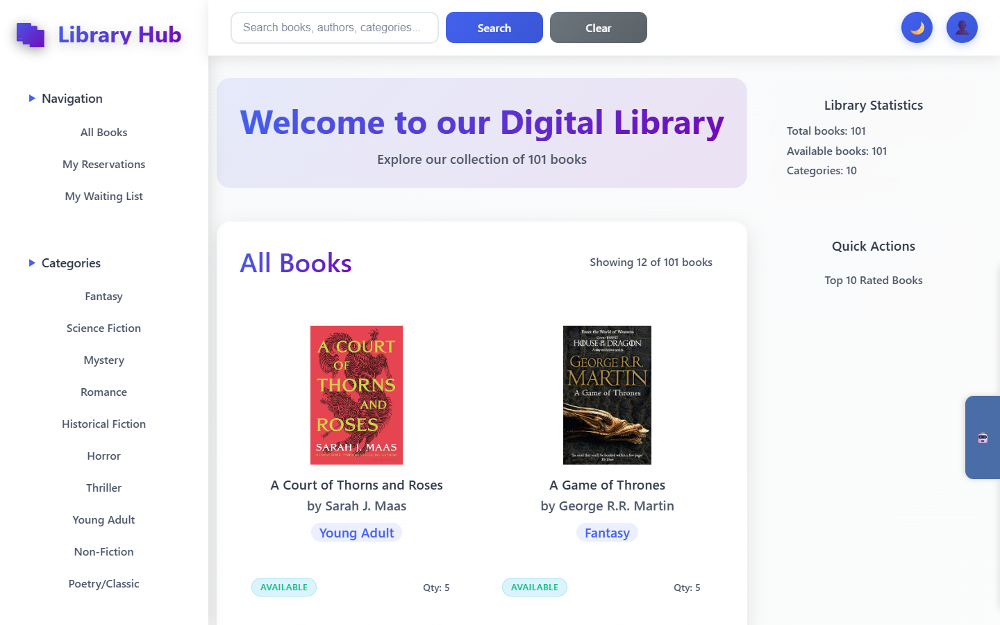
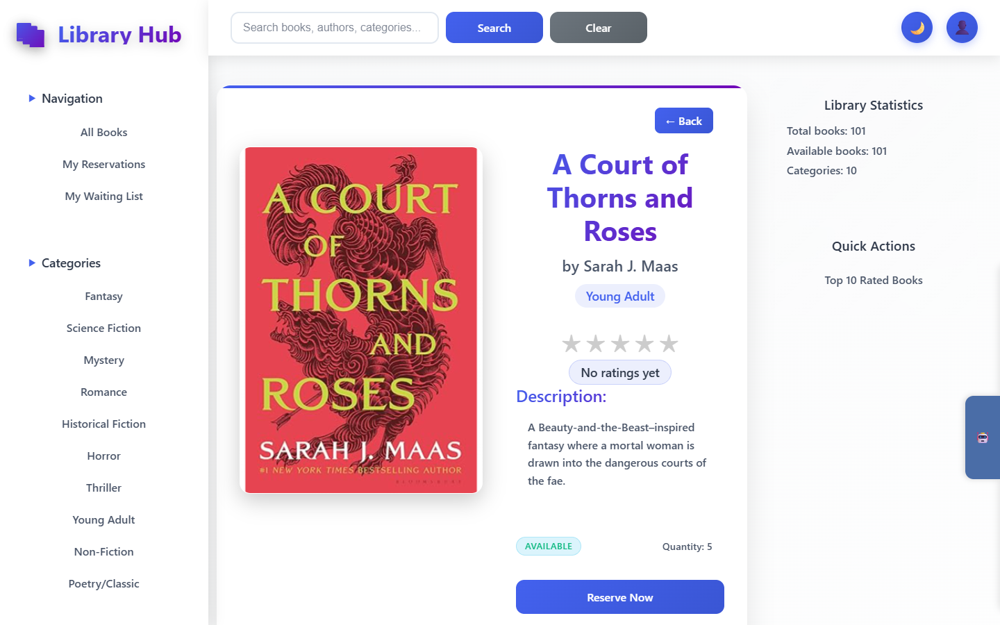
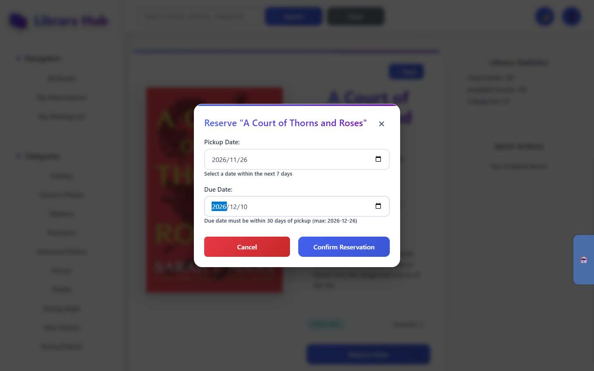
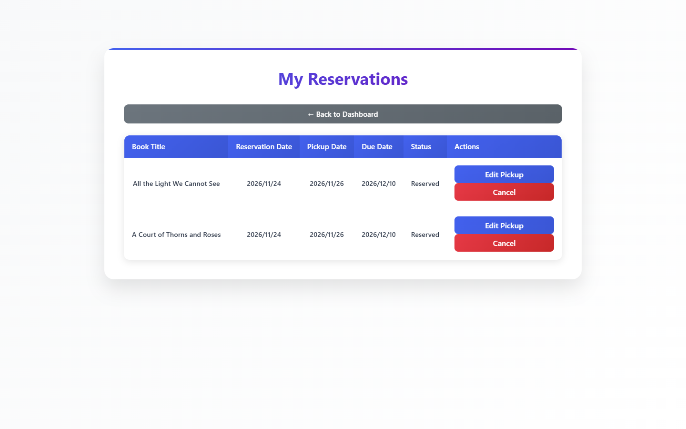

# Library Reservation & Review Hub

[](https://github.com/Jingwei-Lin/library-reservation-hub/actions/workflows/ci.yml)

A full-stack library web app where members can browse books, reserve copies, join a waiting list when every copy
is taken, and share reviews. Built by a team of five for ELEC5619 (Object-Oriented Application Frameworks) at
the University of Sydney, Aug – Nov 2025.

**Stack:** Java 17 · Spring Boot 3.5 · MyBatis-Plus · MySQL · Spring AI · React 19 · Vite ·
JUnit 5 · Mockito · Testcontainers · JaCoCo · Vitest · Docker · GitHub Actions

| Browse the catalogue | Book details |
|---|---|
|  |  |
| **Reserve a copy** | **My reservations** |
|  |  |

## Features

- **Reservations:** reserve and cancel books, change pickup times; admins manage reservation status.
- **Waiting list with notifications:** when every copy is out, users join a queue. A copy that comes back goes
  straight to the first person waiting, who has three days to reserve it before it passes to the next.
- **Stock-aware inventory:** each book tracks the copies on the shelf and the copies held for notified users, so a
  copy held for someone cannot be reserved by anyone else.
- **Books and search:** keyword, genre and availability filters, with pagination and sorting.
- **Reviews and ratings:** users write and edit reviews; average ratings are kept up to date by MySQL triggers.
- **Accounts:** registration and session-based login, with an admin role for the admin panel.
- **AI assistant:** a chat panel that streams book recommendations over Server-Sent Events (Spring AI).

## My contribution

I owned the reservation and waiting-list workflow, end to end:

- **Back end:** `ReservationServiceImpl` and `WaitingListServiceImpl`, and their controllers and mappers.
  - Reserving a copy checks availability and fulfils the user's waiting-list entry.
  - Cancelling a reservation either holds the copy for the next waiting user or releases it to the public.
  - Creating, cancelling and returning a reservation each run in one transaction.
- **Front end:** the main book dashboard (search, genre browsing and top-rated books), the book detail page, and
  the reservation and waiting-list screens.
- **Testing:**
  - Wrote the JUnit and Mockito tests for the reservation service and controller.
  - Added JaCoCo coverage reporting to the Gradle build.
- **Database:** the schema and seed data for books, reservations and the waiting list.

Teammates built user management, reviews and ratings, the admin pages and the AI assistant.

## After the course

- **Fixed a race condition in reservations.**
  - Problem: the service read a book's stock, checked it in Java and wrote the new count back. Concurrent
    requests could deadlock or overwrite each other's counts.
  - Fix: reserving, cancelling and returning now change stock through single conditional `UPDATE`s, for example
    `SET quantity = quantity - 1 WHERE quantity > 0`. The copy is taken before the
    reservation row is inserted, so the book row is always locked first.
  - Test: `ReservationConcurrencyIntegrationTest` runs against MySQL and failed before the fix.
    - Eight users try to reserve the last copy at once, and exactly one succeeds.
    - Three concurrent cancellations all put their copies back.
- **Added CI and Docker:** GitHub Actions, Docker Compose, and fixes for running on Linux (case-sensitive
  table names, UTF-8 seed data, configurable CORS origins).
- **Closed the security holes found in a code review**, each with a test that failed before the fix:
  - `@AuthCheck` is enforced by an interceptor (it was declared but never read, so admin routes were open);
    a reservation is readable only by its owner or an admin;
  - user-list sort fields go through a whitelist instead of into `ORDER BY` as raw SQL;
  - the AI assistant's user tool reads only the signed-in user, set by the server rather than by the model,
    and chat ids must be UUIDs (they named the memory file, so `../` reached other files);
  - passwords are BCrypt (old MD5 hashes are upgraded at the next login), the session id changes at login,
    and changing your e-mail or password needs your current password.
- **Reworked the stock model and the waiting list** to fix the stock bugs from the same review, each with a test
  that failed before the fix:
  - held copies were subtracted from the shelf twice, so a copy on the shelf could not be reserved; they are now
    counted apart, and `available` is set by a trigger from the shelf count;
  - deleting a book only cleared `available`, so the next return brought it back; deleted books have their own
    flag and are hidden from users;
  - a returned copy waited until someone opened the Dashboard, which then let later users jump the queue; now every
    stock change goes through one service that locks the book row first, and the copy goes to the first person
    waiting at once;
  - holds run out three days after the notification (it was seven days after joining, and the copy stayed held);
  - two cancels of one reservation gave back two copies, and a borrowed reservation could be cancelled; a status
    now changes with one conditional `UPDATE`, and unique keys stop duplicate reservations or queue entries.
- **Made the front end notice when a session ends.** The API reports it in the body (`code` 40100, or 40301 for
  a ban) while the pages only checked HTTP 401/403, so nothing ever reacted.
  - Seven axios clients became one, with an interceptor that handles an ended session in one place: a notice,
    and on pages that need an account, sign in and come back to the same page.
  - A refused review no longer signs the user out, and Sign out clears the previous user's chat.
  - Admin page: a failed user edit is no longer retried as an edit of the admin's own profile, the server's
    error text is shown, and there is a Sign out button.
- **Fixed the remaining correctness bugs from the review:**
  - the book list pages on the server, so every book is reachable and the statistics are real counts (it loaded
    at most 101 books); a search starts at page 1, survives a reload, and a slow earlier load can't replace a
    newer list;
  - the AI chat keeps the last 20 messages for 7 days instead of everything forever, no longer stores the user's
    details with each message, and a corrupt history file starts a fresh conversation;
  - the assistant's "recommend some books" tool returns five real books with their details (it returned ids and
    ratings, so the model invented titles);
  - any listed book can be reviewed, even with every copy out, and a new review is validated like an edit.
- **Cleaned up the codebase**, without changing what users see:
  - the back-end tests start their own MySQL with Testcontainers, so `./gradlew test` needs only Docker;
  - table names are lowercase, so the app runs on any MySQL (it needed `lower_case_table_names=1`);
  - removed 12 unused libraries, dead classes and components, debug logging, and 100 duplicate cover images;
  - brought back the disabled tests, with real assertions, and added front-end unit tests (Vitest);
  - split the three largest React components (the admin page, the book page and the book list) into parts;
  - translated the Chinese comments, and rewrote the design document from the code.
- **Closed the remaining low-priority findings**, each with a test that failed before the fix:
  - sign-in gives one message for an unknown e-mail and a wrong password, and refuses an e-mail after five
    failed attempts in 15 minutes;
  - names like O'Brien and phone numbers up to 15 digits register; a `%` search matches only `%`; paging by
    genre no longer repeats or skips books; review dates keep their time; the top 10 orders ties;
  - lists load their users and books in one query instead of one per row, and prompts and personal details are
    out of the normal logs;
  - images in AI replies show as links (nothing loads by itself), and a failed reply says so;
  - front-end fixes (local dates, a 404 page, the placeholder cover, dark mode on sign-in, keyboard access);
  - the back-end container runs as a non-root user with a health check, CI actions are pinned, and the build
    fails below 90% line coverage.

## Architecture

```
React (Vite, :5173)  ──REST / SSE──▶  Spring Boot API (:8432/api)  ──MyBatis-Plus──▶  MySQL
                                        ├─ controllers → services → mappers
                                        ├─ @Scheduled job (hourly: holds that ran out pass to the next person)
                                        └─ Spring AI (DashScope) for the chat assistant
```

API documentation is served by Knife4j / springdoc at `http://localhost:8432/api/swagger-ui.html` when the
back end is running.

## Quick start with Docker

```bash
cp .env.example .env      # optional: add a DashScope key to try the AI assistant
docker compose up --build
```

Open http://localhost:8080 and sign in with a demo account (password `123456789`):
`jingwei.lin2@example.com`, or `admin@admin.com` at `/admin` for the admin panel.

Compose starts three containers:
- MySQL, with the schema and 101 sample books loaded;
- the Spring Boot API;
- the React app, served by nginx, which proxies `/api` to the API.

## Running locally without Docker

**Requirements:** JDK 17, MySQL 8, Node.js 20.19+

1. **Create the database.** Run `LibraryReservationReviewHub/Schema.sql` in MySQL.
2. **Set environment variables.** The back end reads them through `application.yml`:

   | Variable | Default | Purpose |
   |---|---|---|
   | `DB_URL` | `jdbc:mysql://localhost:3306/library_reservation` | JDBC URL |
   | `DB_USERNAME` | `root` | Database user |
   | `DB_PASSWORD` | *(empty)* | Database password |
   | `DASHSCOPE_API_KEY` | *(empty)* | Must be non-empty for the app to start; a real key is only needed for the AI assistant |
   | `CORS_ALLOWED_ORIGINS` | `http://localhost:5173,http://localhost:5174` | Front-end origins allowed to call the API |

3. **Start the back end:**

   ```bash
   cd LibraryReservationReviewHub
   ./gradlew bootRun
   ```

4. **Start the front end:**

   ```bash
   cd frontend
   npm install
   npm run dev        # http://localhost:5173
   ```

## Tests and coverage

**Back end:** `./gradlew test` runs 354 JUnit tests:
- Mockito unit tests for the services and controllers;
- Spring Boot integration tests, including the concurrency tests, against a MySQL 8.4 that Testcontainers starts
  for the run and loads from `Schema.sql`. Docker must be running; no database or environment variables are
  needed.

```bash
cd LibraryReservationReviewHub
./gradlew test jacocoTestReport   # HTML report: build/reports/jacoco/test/html/index.html
```

- **Skipped:** `PersonalAgentTest` calls the real AI model, so it is skipped unless `DASHSCOPE_API_KEY` holds a
  real key.
- **Coverage:** line coverage is 96% overall and 98% for the service layer, and the build fails below 90%
  (`jacocoTestCoverageVerification`). The figures exclude configuration, DTO/VO, exception and `common/`
  classes.

**Front end:** `npm test` (in `frontend/`) runs 55 Vitest tests, some rendering components with Testing
Library: the API client's handling of ended sessions, the sign-in return address, the book list and its
paging, the chat panel, the reserve dialog's dates, keyboard access, and the page fixes.

CI runs both on every push, with the front-end lint and build, and uploads the JaCoCo report.

How the app is built (architecture, data model, the stock and waiting-list rules, sessions, the AI assistant and
an API overview) is described in [docs/DESIGN.md](docs/DESIGN.md).

## Licence

There is no open-source licence. The code was written by a team of five as course work and is shared here so it
can be read; its authors keep the rights to it.
