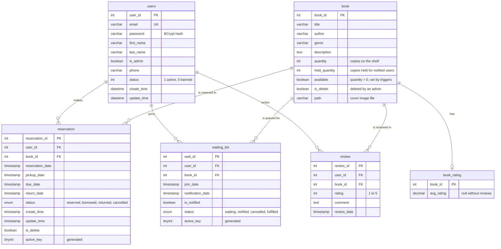

# Library Reservation & Review Hub: design

How the app is built, as of the code on `main`. The README covers what it does and how to run it.

## 1. Architecture

```
React 19 + Vite  ──REST, SSE──▶  Spring Boot 3.5 (/api)  ──MyBatis-Plus──▶  MySQL 8.4
(frontend/)                      (LibraryReservationReviewHub/)               (Schema.sql)
                                  └─ Spring AI ──▶ DashScope (qwen-max)
```

**Back end** (`com.comp5619.libraryreservationreviewhub`):

| Package | What it holds |
|---|---|
| `controller` | REST routes. Every answer is HTTP 200 with a `BaseResponse { code, data, message }` |
| `service`, `service/impl` | The rules. `StockService` makes every change to a book's stock and its queue |
| `mapper` | MyBatis-Plus mappers, SQL in annotations and `resources/mapper/*.xml` |
| `model` | Entities (one per table), request DTOs, response VOs |
| `config` | `AuthInterceptor` (enforces `@AuthCheck`), CORS, MyBatis-Plus paging, chat memory, static covers |
| `job` | Scheduled jobs: expired holds (hourly at :15), idle chat memory (daily at 03:45) |
| `app`, `tools`, `chatmemory`, `advisor` | The AI assistant: agent, tools, file-based memory, logging |
| `exception` | `ErrorCode`, `BusinessException`, `GlobalExceptionHandler` |

**Front end** (`frontend/src`):

| Path | What it holds |
|---|---|
| `App.jsx` | Routes (`/dashboard`, `/login`, `/register`, `/reservations`, `/waitinglist`, `/profile`, `/admin/login`, `/admin/dashboard`) and the session-ended handling |
| `services/api.js` | The one axios client, with the interceptor for ended sessions; one service module per area |
| `components/Dashboard.jsx` + `dashboard/` | The book list: sidebar, grid, pagination, statistics; a book opens in place (`?book=`) |
| `components/Book.jsx` + `book/` | A book's page: details, reserve dialog, waiting list, reviews |
| `components/AdminDashboard.jsx` + `admin/` | The admin page: one section per table |
| `components/ChatPanel.tsx`, `hooks/useChat.ts` | The AI chat panel |

## 2. Data model

`Schema.sql` creates the database, its triggers and the sample data. Table names are lowercase, so it runs on
any MySQL without `lower_case_table_names`.



- **`available`** is never written by the code: `BEFORE INSERT/UPDATE` triggers set it to `quantity > 0`.
- **One active row per user and book.** `active_key` is a generated column that is 1 while a reservation holds a
  copy (`reserved`, `borrowed`) or a queue entry is open (`waiting`, `notified`), and NULL afterwards. A unique
  key on `(user_id, book_id, active_key)` allows any number of finished rows but only one active one.
- **Deleted books** keep their rows (`is_delete`): users no longer see them, admins can restore them.
- **`book_rating`** is kept by triggers on `review` (insert, update, delete), which call `update_book_rating`.

## 3. Stock and the waiting list

A book's copies are in one of three places: on the shelf (`quantity`), held for a user who was notified
(`held_quantity`, always the number of `notified` queue entries), or out with a reservation.

All changes go through `StockService`, which first locks the book row (`SELECT … FOR UPDATE`), so two requests
for one book run one after the other:

| Event | What happens |
|---|---|
| Reserve | A notified user takes the copy held for them; anyone else takes a shelf copy (`quantity - 1` only if `quantity > 0`). Their queue entry, if any, becomes `fulfilled` |
| Cancel a reservation, return a book | The copy goes to the first person waiting (oldest `join_date`, then lowest `wait_id`), who becomes `notified` with a held copy; with nobody waiting it goes back on the shelf |
| Admin adds copies | Each goes to the next person waiting, the rest to the shelf |
| Leave the queue | A copy held for the user passes to the next person |
| Hold runs out | A copy held for 3 days (`HOLD_DAYS`) without a reservation: the entry is `cancelled` and the copy passes on. `WaitingListJanitor` checks hourly |

**Reservation statuses:** `reserved` → `borrowed` (admin: Confirm Borrow) → `returned` (admin: Confirm Return);
`reserved` → `cancelled` (the user or an admin). Nothing else is allowed. "Overdue" is not a status: the admin
page marks reservations due today or past due. Each change is one conditional `UPDATE … WHERE status = <from>`,
so two cancels of one reservation give back one copy.

## 4. Reviews

Any listed book can be reviewed by a signed-in user, also when every copy is out. A review has a rating from 1
to 5 and a comment of up to 1000 characters; creating and editing check the same rules. A user may review a book
more than once. A review can be edited or deleted by its author or an admin (the book page offers Delete; the
admin page edits and deletes).

## 5. Accounts, sessions and errors

- **Sign-in** stores the user in the HTTP session (`user_login`). The session id changes at sign-in.
- **Passwords** are BCrypt; an old MD5 hash is replaced at the user's next sign-in. Changing your own e-mail or
  password needs your current password, and a new password signs out your other sessions.
- **Access:** `@AuthCheck` on a route needs a signed-in user, `@AuthCheck(mustRole = "admin")` an admin;
  `AuthInterceptor` enforces both. `getLoginUser` reloads the user on each request, so a ban takes effect at once.
- **Errors** are HTTP 200 with a code in the body:

| Code | Meaning |
|---|---|
| 0 | OK |
| 40000 | Invalid request (the message says what) |
| 40100 | Not signed in, or the session ended |
| 40101 | No permission |
| 40300 / 40301 | Forbidden / the user is banned |
| 40400 / 40401 | Not found / book not found |
| 50000 / 50001 | Server error (no details) / the operation could not be done |

- **Front end:** the interceptor in `services/api.js` turns 40100 and 40301 into a `SessionEndedError` and tells
  `App` once, which shows a notice and, on pages that need an account, sends the user to sign in with a
  `?redirect=` back to the page (`safeRedirect` follows only paths inside the app).

## 6. The AI assistant

- **Route:** `GET /api/ai/personal_agent/chat/server_sent_event?message=…&chatId=…`, streamed as Server-Sent
  Events. The chat id must be a UUID (it names the memory file).
- **Model:** DashScope `qwen-max` through Spring AI's `ChatClient` (`PersonalAgent`). The signed-in user's
  details go into that turn's system prompt, not into the stored conversation.
- **Tools:** `search_books`, `get_books_by_genre`, `get_random_books` (five available books with details),
  `get_book_by_id`, `check_book_availability`, and `get_user_info`. The user tool takes no arguments: the user id
  comes from the `ToolContext` the server sets, so the model can only read the signed-in user.
- **Memory:** one Kryo file per conversation (`FileBasedChatMemory`), the last 20 messages, starting at a user
  message. Conversations idle for 7 days are deleted by `ChatMemoryJanitor`; an unreadable file starts a fresh
  conversation.

## 7. Tests

- **Back end:** `./gradlew test` runs Mockito unit tests and Spring Boot integration tests. The integration tests
  start one MySQL 8.4 with Testcontainers for the run, loaded from `Schema.sql` (`support/TestDatabase`), so
  only Docker is needed. Concurrency tests run real transactions against it.
- **Front end:** `npm test` runs Vitest: the API interceptor, `safeRedirect`, the paging helpers, the admin
  helpers, and the pagination bar (Testing Library on jsdom).
- **CI** runs both, with lint and the front-end build, on every push.
